```text
╔═════════════════════════════════════════════════════════════════════════════════════╗
║   ██╗     ██╗██╗   ██╗██╗███╗   ██╗ ██████╗     ██╗    ██╗██╗██╗  ██╗██╗            ║
║   ██║     ██║██║   ██║██║████╗  ██║██╔════╝     ██║    ██║██║██║ ██╔╝██║            ║
║   ██║     ██║██║   ██║██║██╔██╗ ██║██║  ███╗    ██║ █╗ ██║██║█████═╝ ██║            ║
║   ██║     ██║╚██╗ ██╔╝██║██║╚██╗██║██║   ██║    ██║███╗██║██║██╔═██╗ ██║            ║
║   ███████╗██║ ╚████╔╝ ██║██║ ╚████║╚██████╔╝    ╚███╔███╔╝██║██║  ██╗██║            ║
║   ╚══════╝╚═╝  ╚═══╝  ╚═╝╚═╝  ╚═══╝ ╚═════╝      ╚══╝╚══╝ ╚═╝╚═╝  ╚═╝╚═╝            ║
║                                                                                     ║
║   [ LIVING-WIKI // AUTONOMOUS AI SECOND BRAIN // VINTAGE CYBER EDITION ]           ║
║   SYS_STATUS: [ ONLINE ]   RELEASE: [ v1.0.1 FINAL ]   ARCH: [ ZERO-DB MARKDOWN ]   ║
╚═════════════════════════════════════════════════════════════════════════════════════╝
```

<p align="center">
  
</p>

```text
┌─────────────────────────────────────────────────────────────────────────────────────┐
│ 3D PIPELINE: SILICON GRAPHICS OPENGL 1.1 WIREFRAME  •  RESOLUTION: 60 FPS VECTOR    │
│ PROTOCOL: KARPATHY LLM-WIKI  •  ENGINE: SOL-PI + HERMES  •  STORAGE: ZERO-DB (.MD)  │
└─────────────────────────────────────────────────────────────────────────────────────┘
```

```text
┌─[ SYSTEM BOOT & DIAGNOSTICS SEQUENCE ]──────────────────────────────────────────────┐
│ [✓] INIT_CORE: Karpathy LLM-Wiki Protocol ................................ [ READY ] │
│ [✓] MOUNT_VAULT: wiki/ self/ journal/ raw/ attachments/ .................. [ READY ] │
│ [✓] LOAD_ENGINE: SoL-Pi Evidence Reducer & ObservationPack ............... [ READY ] │
│ [✓] LOAD_HERMES: Zero-LLM SubjectExtractor & Prompt-Cache Auditor ........ [ READY ] │
│ [✓] AGENT_STATUS: Full-Auto Background Self-Development (No Interruptions) [ ACTIVE] │
└────────────────────────────────────────────────────────────────────────────────────┘
```

> **In English:** A lightweight, self-improving personal knowledge base and self-development loop for AI coding agents (Claude Code, Cursor, Windsurf, Antigravity, Cline, Codex, Gemini CLI). Built entirely on plain Markdown linked with Obsidian-style `[[wikilinks]]` — **zero external databases, zero API keys, zero embeddings**. Install in Claude Code with `/plugin marketplace add timurthenix-glitch/living-wiki` then `/plugin install living-wiki@living-wiki`.

---

```text
┌────────────────────────────────────────────────────────────────────────────────────┐
│ [01] SYSTEM MANIFESTO // В ЧЁМ СУТЬ СИСТЕМЫ                                        │
└────────────────────────────────────────────────────────────────────────────────────┘
```

**Живая Вики** — это Obsidian-совместимая персональная база знаний и контур непрерывного саморазвития, которую ведёт AI-агент:
1. **Полный автоматизм (Zero-Friction):** Агент сам выявляет уроки, цели, решения, привычки и грабли из контекста диалога и фиксирует их в фоне, не задавая душных вопросов *«хотите, чтобы я это записал?»*.
2. **Идея Андрея Карпати:** Вместо раздутых векторных баз агент сам ходит по markdown-файлам через `[[двусторонние ссылки]]` и MOC-индексы.
3. **Открыл папку в Obsidian — увидел растущий 3D-граф:** Все данные принадлежат вам, читаются человеком и работают оффлайн в любом текстовом редакторе.
4. **Технические якоря для вайбкодинга:** Вместо академической воды агент фиксирует уроки по схеме *«Что сделали / Первопричина под капотом / Если тронешь — сломается»*, защищая код от циклической амнезии LLM.

---

```text
┌────────────────────────────────────────────────────────────────────────────────────┐
│ [02] VAULT ARCHITECTURE & MEMORY HIERARCHY (LOD)                                  │
└────────────────────────────────────────────────────────────────────────────────────┘
```

```text
 <VAULT_ROOT>/
 ├── index.md                 ── Главный кибер-индекс и навигационный MOC-хаб
 ├── log.md                   ── Линейная хроника всех транзакций агента (Append-only)
 ├── AGENTS.md                ── Единый свод правил и архитектуры памяти (v1)
 ├── dashboard.html           ── 3D Cyberpunk HUD терминал управления
 ├── attachments/             ── Скриншоты UI-багов, ошибок и схемы к урокам
 ├── raw/                     ── Входящий буфер сырых выгрузок и клипов
 │   └── processed/           ── Обработанные источники после дистилляции в wiki/
 ├── wiki/                    ── Предметная база объективных знаний (MOC)
 │   └── <тема>/index.md      ── Тематические хабы заметок
 ├── self/                    ── Контур саморазвития агента и человека
 │   ├── Goals.md             ── Активные векторы и цели
 │   ├── Habits.md            ── Стрики регулярных привычек
 │   ├── Lessons-Learned.md   ── LOD 1: Активные уроки последних недель (< 200 строк)
 │   ├── Skills.md            ── Реестр проверенных навыков
 │   ├── Lessons/             ── LOD 2: Исторический архив уроков (дампы срезов)
 │   └── Reviews/             ── Еженедельные и ежемесячные ретроспективы
 └── journal/                 ── Дневник сессий (<YYYY-MM-DD>.md)
```

### 3-уровневая модель памяти (Level of Detail — LOD):
* **LOD 0 (Атлас и защита контекста):** `python scripts/engine.py status` — ультра-компактный срез (~150 токенов). Запрещает агенту слепо сканировать файлы базы, сохраняя контекстное окно.
* **LOD 1 (Рабочий срез уроков):** `self/Lessons-Learned.md` держится строго компактным (до 150–200 строк / ~25 КБ) для сохранения prompt-кэша.
* **LOD 2 (Исторический архив):** `self/Lessons/` хранит долгосрочный опыт без потери семантического поиска SQLite (`engine.py sync` индексирует и архив, и активные уроки).

---

```text
┌────────────────────────────────────────────────────────────────────────────────────┐
│ [03] RUNTIME ENGINE // ЭФФЕКТИВНОСТЬ SOL-PI + HERMES                               │
└────────────────────────────────────────────────────────────────────────────────────┘
```

В проект встроен бескомпромиссный движок эффективности `scripts/engine.py`, объединяющий принципы **NVIDIA SoL-Pi** и **Hermes Agent**:

```text
┌─[ COMMAND MATRIX: scripts/engine.py ]──────────────────────────────────────────────┐
│                                                                                    │
│ 1. status          ── Сверхкомпактный Атлас хранилища (LOD 0, ~150 токенов)        │
│ 2. audit           ── Панель аудита памяти: вес в токенах и здоровье prompt-кэша   │
│ 3. subjects        ── Zero-LLM: детерминированное извлечение тем и сущностей       │
│ 4. digest-today    ── Сборка хроники дня из log.md и git напрямую в журнал         │
│ 5. session-start   ── Открыть компактный буфер сессии (Session Recorder)           │
│ 6. session-close   ── Собрать итог сессии в одну запись без дублей и шума          │
│ 7. fuse "<cmd>"    ── Action Fusion: запуск команды с авто-сжатием логов и синком  │
│ 8. reduce <log>    ── Evidence Reducer: сжатие лога с посимвольной верификацией    │
│ 9. match "<query>" ── Локальный семантический поиск проверенных решений (>= 0.88)  │
│ 10. sync           ── Индексация markdown-уроков в легковесную SQLite память       │
│                                                                                    │
└────────────────────────────────────────────────────────────────────────────────────┘
```

---

```text
┌────────────────────────────────────────────────────────────────────────────────────┐
│ [04] QUICK START & INSTALLATION // БЫСТРЫЙ СТАРТ                                   │
└────────────────────────────────────────────────────────────────────────────────────┘
```

### Вариант A. Claude Code (в 1 команду через маркетплейс)

```bash
/plugin marketplace add timurthenix-glitch/living-wiki
/plugin install living-wiki@living-wiki
```
После установки просто скажите агенту в любом проекте: `«настрой мне живую вики»`.

### Вариант B. Любой другой агент / IDE (Cursor, Windsurf, Cline, Antigravity, Copilot)

1. Скопируйте файл `AGENTS.md` из этого репозитория в корень вашего проекта.
2. Скопируйте соответствующий файл-указатель (`.cursor/rules/living-wiki.md`, `.windsurf/rules/living-wiki.md` и т.д.).
3. Скажите агенту в начале сессии: `«прочитай AGENTS.md, дальше следуй ему»`.

---

```text
┌────────────────────────────────────────────────────────────────────────────────────┐
│ [05] VERSIONING POLICY // ЕДИНАЯ ВЕРСИЯ v1                                         │
└────────────────────────────────────────────────────────────────────────────────────┘
```

В проекте действует **строгая политика единой финальной версии v1**:
* Никаких подверсий, параллельных веток (v2, v1.1) для схемы памяти не создаётся.
* Все улучшения (Session Recorder, модули Hermes, технические якоря) вносятся **напрямую в v1** в `AGENTS.md` и `SKILL.md`.
* Обновление инструкций **никогда не стирает накопленные данные пользователя** (`wiki/`, `self/`, `journal/`, `raw/`, `attachments/`, `log.md`).

---

```text
╔═════════════════════════════════════════════════════════════════════════════════════╗
║  LICENSE: MIT  •  CREATED BY: timurthenix-glitch  •  INSPIRED BY: Andrej Karpathy   ║
║  "Teach toward reconstruction, preserve context, protect the prompt cache."        ║
╚═════════════════════════════════════════════════════════════════════════════════════╝
```
