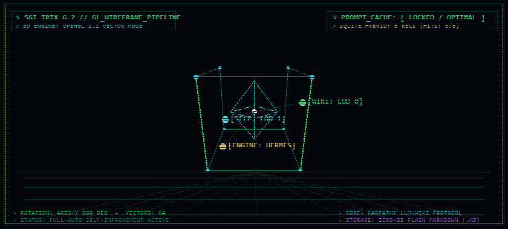

```text
 ╔══════════════════════════════════════════════════════════════════════════════════╗
 ║  _     _____ _   _ _____ _   _ _____   _    _ _____ _   ______                   ║
 ║ | |   |_   _| | | |_   _| \ | |  __ \ | |  | |_   _| | / /_   _|                  ║
 ║ | |     | | | | | | | | |  \| | |  \/ | |  | | | | | |/ /  | |                    ║
 ║ | |     | | | | | | | | | . ` | | __  | |/\| | | | |    \  | |                    ║
 ║ | |_____| |_\ \_/ /_| |_| |\  | |__\ \ \  /\  /_| |_| |\  \_| |_                  ║
 ║ \_____/\___/ \___/ \___/\_| \_/ \____/  \/  \/ \___/\_| \_/\___/                  ║
 ║                                                                                  ║
 ║ >> CYBERNETIC KNOWLEDGE VAULT & ZERO-FRICTION SELF-DEVELOPMENT SYSTEM // 1996 << ║
 ╚══════════════════════════════════════════════════════════════════════════════════╝
```

<p align="center">
  
</p>

```diff
+ [✓] SYS_CORE:         Karpathy LLM-Wiki Knowledge Topology ........ [ ONLINE ]
+ [✓] STORAGE:          Pure Human-Readable Markdown (Zero-DB) ...... [ MOUNTED]
! [i] ENGINE_SUITE:     SoL-Pi (Evidence Reducer) + Hermes (Nous) ... [ LOADED ]
! [i] TOKEN_SHIELD:     LOD-0 Status (~150 tok) & LOD-1 (<200 lines)  [ LOCKED ]
+ [✓] AGENT_LOOP:       Full-Auto Autonomous Background Capture ..... [ ACTIVE ]
```

> **In English:** A lightweight, self-improving personal knowledge base and self-development loop for AI coding agents (*Claude Code, Cursor, Windsurf, Antigravity, Cline, Codex, Gemini CLI*). Built entirely on plain Markdown linked with Obsidian-style `[[wikilinks]]` — **zero external databases, zero API keys, zero embeddings**. Install in Claude Code with `/plugin marketplace add timurthenix-glitch/living-wiki` then `/plugin install living-wiki@living-wiki`.

---

### 01. SYSTEM MANIFESTO // СУТЬ СИСТЕМЫ

**Живая Вики** — это Obsidian-совместимая база знаний и контур непрерывного саморазвития, которую ведёт AI-агент:

1. **Полный автоматизм (Zero-Friction):** Агент сам выявляет уроки, цели, решения, привычки и грабли из контекста диалога и фиксирует их в фоне, не задавая душных вопросов *«хотите, чтобы я это записал?»*.
2. **Архитектура Андрея Карпати:** Вместо раздутых векторных баз агент сам ходит по markdown-файлам через `[[двусторонние ссылки]]` и MOC-индексы (Maps of Content).
3. **Открыл папку в Obsidian — увидел растущий 3D-граф:** Все данные принадлежат вам, читаются человеком и работают оффлайн в любом текстовом редакторе.
4. **Технические якоря для вайбкодинга:** Вместо академической воды агент фиксирует уроки по схеме *«Что сделали / Первопричина под капотом / Если тронешь — сломается»*, защищая код от циклической амнезии LLM.

---

### 02. VAULT ARCHITECTURE & MEMORY HIERARCHY

```text
 <VAULT_ROOT>/
 ├── index.md                 ── Главный кибер-индекс и навигационный MOC-хаб
 ├── log.md                   ── Линейная хроника всех транзакций агента (Append-only)
 ├── AGENTS.md                ── Единый свод правил и архитектуры памяти (v1)
 ├── attachments/             ── Скриншоты UI-багов, ошибок и схемы к урокам
 ├── raw/                     ── Входящий буфер сырых выгрузок и клипов
 │   └── processed/           ── Обработанные источники после дистилляции в wiki/
 ├── wiki/                    ── Предметная база объективных знаний (MOC)
 │   └── <тема>/index.md      ── Тематические хабы заметок
 ├── self/                    ── Контур саморазвития агента и человека
 │   ├── Goals.md             ── Активные векторы и цели
 │   ├── Habits.md            ── Стрики регулярных привычек
 │   ├── Lessons-Learned.md   ── LOD 1: Активные уроки последних недель (< 200 строк)
 │   ├── Skills.md            ── Реестр проверенных навыков
 │   ├── Lessons/             ── LOD 2: Исторический архив уроков (дампы срезов)
 │   └── Reviews/             ── Еженедельные и ежемесячные ретроспективы
 └── journal/                 ── Дневник сессий (<YYYY-MM-DD>.md)
```

#### 3-уровневая модель памяти (Level of Detail — LOD):
* **LOD 0 (Атлас и защита контекста):** `python scripts/engine.py status` — ультра-компактный срез (~150 токенов). Запрещает агенту слепо сканировать файлы базы, сохраняя контекстное окно.
* **LOD 1 (Рабочий срез уроков):** `self/Lessons-Learned.md` держится строго компактным (до 150–200 строк / ~25 КБ) для сохранения prompt-кэша.
* **LOD 2 (Исторический архив):** `self/Lessons/` хранит долгосрочный опыт без потери семантического поиска SQLite (`engine.py sync` индексирует и архив, и активные уроки).

---

### 03. RUNTIME COMMAND MATRIX (`scripts/engine.py`)

```ini
[LOD-0_ATLAS]
status           = Сверхкомпактный атлас хранилища (~150 токенов для экономии контекста)

[HERMES_AUDIT]
audit            = Панель аудита памяти, структуры тем и целостности prompt-кэша
subjects         = Zero-LLM детерминированное извлечение тем, сущностей и кандидатов
digest-today     = Детерминированная сборка хроники дня из log.md и git в journal/

[SESSION_RECORDER & SUBAGENTS]
session-start    = Открыть компактный буфер рабочей сессии (поддержка --agent <id>)
record           = Добавить одно значимое событие в буфер сессии
session-close    = Собрать итог сессии в одну запись без спама и шума
harvest-subagent = Извлечь Технический якорь из ответа субагента в Lessons-Learned.md

[SOL-PI_EXECUTION]
fuse "<cmd>"     = Запуск команды со сжатием логов и фоновой синхронизацией
reduce <log>     = Сжатие лога с посимвольной проверкой и сохранением сути ошибки
pack <file>      = Упаковать объёмный материал в легковесный ObservationPack
recall <handle>  = Прочитать срез строк из ObservationPack
clean            = Удалить устаревшие архивы логов и наблюдений

[SEMANTIC_MEMORY]
match "<query>"  = Поиск проверенных решений в локальном SQLite (порог >= 0.88)
store "<q>" "<a>"= Сохранить проверенное решение в память
sync             = Индексация уроков, архивов и заметок wiki/ в семантическую память
```

**Где лежит vault.** Корень определяется однозначно: `$LIVING_WIKI_VAULT` (или `~/.living-wiki-path`), иначе ближайший вверх по дереву каталог с `self/` или `wiki/`. Если vault не найден, `status` выводит `VAULT НЕ НАСТРОЕН`, а команды записи отказываются работать — вместо того чтобы тихо разложить `.cache/` по подкаталогам вашего проекта.

**Где лежат скрипты.** При установке через плагин — `${CLAUDE_PLUGIN_ROOT}/scripts/engine.py`; при работе из клона этого репозитория — `python scripts/engine.py`.

---

### 04. QUICK START & INSTALLATION

#### Вариант A. Claude Code (в 1 команду через маркетплейс)

```bash
/plugin marketplace add timurthenix-glitch/living-wiki
/plugin install living-wiki@living-wiki
```
После установки просто скажите агенту в любом проекте: `«настрой мне живую вики»`.

#### Вариант B. Любой другой агент / IDE (Cursor, Windsurf, Cline, Antigravity, Copilot)

1. Скопируйте файл `AGENTS.md` из этого репозитория в корень вашего проекта.
2. Скопируйте соответствующий файл-указатель (`.cursor/rules/living-wiki.md`, `.windsurf/rules/living-wiki.md` и т.д.).
3. Скажите агенту в начале сессии: `«прочитай AGENTS.md, дальше следуй ему»`.

---

### 05. VERSIONING POLICY // ЕДИНАЯ ВЕРСИЯ v1

В проекте действует **строгая политика единой финальной версии v1**:
* Никаких подверсий, параллельных веток (v2, v1.1) для схемы памяти не создаётся.
* Все улучшения (Session Recorder, модули Hermes, технические якоря) вносятся **напрямую в v1** в `AGENTS.md` и `SKILL.md`.
* Обновление инструкций **никогда не стирает накопленные данные пользователя** (`wiki/`, `self/`, `journal/`, `raw/`, `attachments/`, `log.md`).

---

```text
 ╔══════════════════════════════════════════════════════════════════════════════════╗
 ║  LICENSE: MIT // AUTHOR: timurthenix-glitch // LIVING-WIKI v1 FINAL             ║
 ╚══════════════════════════════════════════════════════════════════════════════════╝
```
